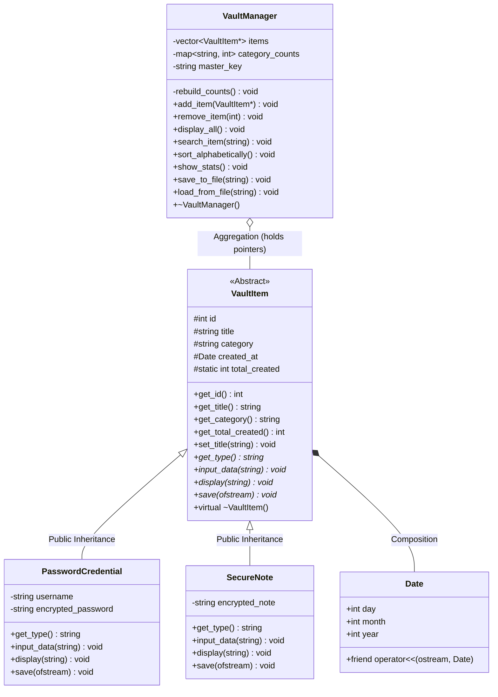

# Comprehensive Guide: CLI Password & Secret Vault (`vault.cpp`)

This document serves as an exhaustive, line-by-line and architectural guide to the **CLI Password & Secret Vault** project implemented in [`vault.cpp`](file:///c:/Users/LENOVO/forcode/College/sem3/employee-management/vault.cpp). 

It is designed for students, educators, and software engineers who wish to understand the software design principles, Object-Oriented Programming (OOP) paradigms, standard template library (STL) usage, file I/O mechanics, and cryptographic concepts integrated into this single-file C++ application.

---

## Table of Contents
1. [Project Overview & Purpose](#1-project-overview--purpose)
2. [Syllabus & Concept Matrix (Groups A, B & C)](#2-syllabus--concept-matrix-groups-a-b--c)
3. [Architecture & Class Hierarchy](#3-architecture--class-hierarchy)
4. [Line-by-Line & Block-by-Block Walkthrough](#4-line-by-line--block-by-block-walkthrough)
   - [4.1 Headers and Macro Definitions](#41-headers-and-macro-definitions)
   - [4.2 UI Helpers & Generic Function Template](#42-ui-helpers--generic-function-template)
   - [4.3 The Cryptographic Engine (`cipher_text`)](#43-the-cryptographic-engine-cipher_text)
   - [4.4 Composition & Operator Overloading (`struct Date`)](#44-composition--operator-overloading-struct-date)
   - [4.5 Abstract Base Class (`VaultItem`)](#45-abstract-base-class-vaultitem)
   - [4.6 Derived Concrete Classes (`PasswordCredential` & `SecureNote`)](#46-derived-concrete-classes-passwordcredential--securenote)
   - [4.7 The Core Manager (`VaultManager`)](#47-the-core-manager-vaultmanager)
   - [4.8 Program Entry Point & Main Event Loop (`main`)](#48-program-entry-point--main-event-loop-main)
5. [Storage Format Specification (`vault.dat`)](#5-storage-format-specification-vaultdat)
6. [Compilation & Execution Instructions](#6-compilation--execution-instructions)

---

## 1. Project Overview & Purpose

The **CLI Password & Secret Vault** is an offline, terminal-based personal security manager written in modern C++ (C++17). 

### Core Features:
- **Master Password Authentication:** Locks access to all saved records. The vault file (`vault.dat`) cannot be read without supplying the correct master key.
- **Client-Side Reversible Encryption:** Every credential and note is scrambled in memory before writing to disk and decrypted dynamically upon retrieval.
- **Polymorphic Storage:** Accommodates multiple distinct categories of secrets (login credentials and free-form secure notes) inside a unified collection.
- **In-Memory Manipulation & Single-Exit Persistence:** Records are managed in dynamic memory during runtime (supporting adding, deleting, keyword searching, and alphabetical sorting) and committed to disk upon safe exit.

---

## 2. Syllabus & Concept Matrix (Groups A, B & C)

The project unifies all core competencies covered across Semester 3 Object-Oriented Programming coursework into a cohesive application:

| Group / Category | Concept | Implementation Location in `vault.cpp` | Explanation |
| :--- | :--- | :--- | :--- |
| **Group A** | **Encapsulation & Access Modifiers** | `VaultItem`, `PasswordCredential`, `SecureNote`, `VaultManager` | All sensitive variables (`id`, `encrypted_password`, `items`, etc.) are declared `private` or `protected`. |
| **Group A** | **Constructors & Initializer Lists** | Lines 103, 145, 203 | Parameterized constructors utilize member initializer syntax (`: id(item_id), title(t)...`) for initialization efficiency. |
| **Group A** | **Copy Constructor** | Line 109 (`VaultItem`) | Explicit copy constructor handling object duplication and tracking instances. |
| **Group A** | **Const-Correctness** | Lines 116–118, 296, 337 | Member functions that do not alter class state are explicitly decorated with `const`. |
| **Group A** | **Static Data & Functions** | Lines 100, 119, 134 (`total_created`) | Tracks the total count of vault objects instantiated during the program's lifecycle across all instances. |
| **Group A** | **Class Composition** | Line 99 (`Date created_at;`) | Complex data structure embedding: `VaultItem` embeds a custom `struct Date`. |
| **Group B** | **Stream File I/O (`fstream`)** | Lines 354–419 (`save_to_file`, `load_from_file`) | Full disk persistence writing formatted tokens and reading structured data using `ifstream` and `ofstream`. |
| **Group B** | **Exception Handling (`stdexcept`)** | Lines 57, 123, 155, 309, 458 | Uses `throw invalid_argument(...)` and `throw runtime_error(...)`, caught in `main()` with standard `try { ... } catch (const exception& e)` blocks. |
| **Group B** | **Input Stream Sanitization** | Lines 450–456, 33–37 | Recovers from invalid terminal inputs using `cin.clear()`, bad input consumption, and `cin.peek()` / `cin.ignore()`. |
| **Group C** | **Abstract Base Class & Pure Virtuals** | Lines 90–132 (`VaultItem`) | Class containing `= 0` pure virtual functions (`get_type`, `input_data`, `display`, `save`). Cannot be instantiated on its own. |
| **Group C** | **Runtime Polymorphism & Virtual Destructor**| Lines 114, 287, 477–484 | `vector<VaultItem*>` holds heterogeneous derived objects; calls to `display()` or `save()` dispatch dynamically. `virtual ~VaultItem()` guarantees safe memory deallocation. |
| **Group C** | **Operator Overloading** | Lines 80–84 (`operator<<`) | Overloads stream insertion for `struct Date`, allowing direct printing with `cout << created_at`. |
| **Group C** | **Function Templates** | Lines 43–47 (`template <typename T> print_stat`) | Generic printing function that accepts any streamable type `T`. |
| **Group C** | **Standard Template Library (STL)** | Lines 250, 251, 313, 330 | Uses `std::vector` (dynamic array), `std::map` (category count aggregation), `std::sort` (alphabetical sorting via lambda), and `std::find_if` (predicate-based search). |

---

## 3. Architecture & Class Hierarchy



### Why Pointers (`VaultItem*`) Are Used
In C++, storing derived objects by value inside a `vector<VaultItem>` causes **object slicing**: the extra member variables of `PasswordCredential` (`username`, `encrypted_password`) would be sheared off, leaving only the base `VaultItem`. Storing pointers (`VaultItem*`) preserves the full derived instance on the heap and enables runtime virtual method dispatch.

---

## 4. Line-by-Line & Block-by-Block Walkthrough

### 4.1 Headers and Macro Definitions (Lines 1–18)
```cpp
#include <iostream>
#include <fstream>
#include <string>
#include <vector>
#include <map>
#include <algorithm>
#include <stdexcept>
#include <cstdlib>
#include <cctype>

#define VAULT_FILE "vault.dat"
#define VERIFY_TOKEN "VAULT_OK"

#define ASCII_PRINT_START 33   // '!'
#define ASCII_PRINT_END   126  // '~'
#define ASCII_RANGE_SIZE  (ASCII_PRINT_END - ASCII_PRINT_START + 1) // 94 printable characters
```
- **Standard Libraries:** 
  - `<fstream>` provides file streams (`ifstream`, `ofstream`).
  - `<vector>` and `<map>` provide dynamic arrays and associative key-value trees.
  - `<algorithm>` provides `std::sort` and `std::find_if`.
  - `<stdexcept>` provides standard exception classes (`invalid_argument`, `runtime_error`).
- **Macros:**
  - `VAULT_FILE`: Centralizes the persistence storage filename.
  - `VERIFY_TOKEN`: A known phrase encrypted into line 1 of the vault file. Upon subsequent logins, decrypting this token verifies whether the entered master password is correct.
  - `ASCII_PRINT_START` (33) to `ASCII_PRINT_END` (126): Defines the exact bounds of printable non-whitespace ASCII characters. `ASCII_RANGE_SIZE` (94) is the modulus base for the cipher. Space (ASCII 32) is deliberately omitted so serialized encrypted tokens contain no whitespace, allowing straightforward extraction using `operator>>`.

---

### 4.2 UI Helpers & Generic Function Template (Lines 20–52)
```cpp
void clear_terminal()
{
#ifdef _WIN32
    system("cls");
#else
    system("clear");
#endif
}
```
- **Cross-Platform Compatibility:** Checks preprocessor flag `_WIN32`. On Windows platforms, it invokes `cls`; on Linux/macOS, it issues `clear`.

```cpp
void back_to_menu()
{
    string temp;
    cout << "\nEnter any key to go back to menu: ";
    cin >> temp;
    clear_terminal();
}
```
- **Menu Pause & Screen Reset:** Prompts the user to enter any character or key, waits for input via `cin >> temp`, and immediately clears the console screen to restore the menu interface cleanly (identical to the pattern used in `gC.cpp`).

```cpp
template <typename T>
void print_stat(string label, T value)
{
    cout << "  " << label << ": " << value << endl;
}
```
- **Template Metaprogramming (Group C):** A generic function template. `T` is determined at compile-time by the compiler, allowing this single function to accept `size_t`, `int`, `string`, or `double` without duplicate function overloads.

---

### 4.3 The Cryptographic Engine (`cipher_text`) (Lines 54–78)
```cpp
string cipher_text(string text, string key, bool encrypt)
{
    if (key.empty())
    {
        throw invalid_argument("Key cannot be empty");
    }

    for (size_t i = 0; i < text.size(); i++)
    {
        unsigned char c = text[i];
        if (c >= ASCII_PRINT_START && c <= ASCII_PRINT_END)
        {
            int shift = key[i % key.size()] % ASCII_RANGE_SIZE;
            int offset = c - ASCII_PRINT_START;
            int res = encrypt ? (offset + shift) % ASCII_RANGE_SIZE 
                              : (offset - shift + ASCII_RANGE_SIZE) % ASCII_RANGE_SIZE;
            text[i] = static_cast<char>(ASCII_PRINT_START + res);
        }
    }
    return text;
}
```
- **Algorithm Mechanics:** 
  - Operates as a rotating-key polyalphabetic cipher (Vigenère/Caesar variant).
  - `shift = key[i % key.size()] % 94`: Loops the key continuously across the input text length.
  - `offset = c - 33`: Normalizes character index to a zero-based range `[0, 93]`.
  - **Encryption:** `(offset + shift) % 94` slides the character forward.
  - **Decryption:** `(offset - shift + 94) % 94` slides the character backward. Adding `ASCII_RANGE_SIZE` (94) prevents negative modulo results in C++.
  - Re-adds `ASCII_PRINT_START` (33) to convert back into printable ASCII characters.

---

### 4.4 Composition & Operator Overloading (`struct Date`) (Lines 80–92)
```cpp
struct Date
{
    int day, month, year;

    friend ostream& operator<<(ostream& os, const Date& d)
    {
        os << d.day << "/" << d.month << "/" << d.year;
        return os;
    }
};
```
- **Class Composition:** Encapsulates calendar data within a structured type.
- **Operator Overloading:** Overloads the stream insertion operator `<<`. Declaring it as a `friend` gives the operator access to format output directly into standard output streams (`cout << created_at`).

---

### 4.5 Abstract Base Class (`VaultItem`) (Lines 94–136)
```cpp
class VaultItem
{
protected:
    int id;
    string title;
    string category;
    Date created_at;
    static int total_created;

public:
    VaultItem(int item_id = 0, string t = "Untitled", string cat = "General", Date d = {1, 1, 2026})
        : id(item_id), title(t), category(cat), created_at(d)
    {
        total_created++;
    }

    VaultItem(const VaultItem& other)
        : id(other.id), title(other.title), category(other.category), created_at(other.created_at)
    {
        total_created++;
    }

    virtual ~VaultItem() {}

    int get_id() const { return id; }
    string get_title() const { return title; }
    string get_category() const { return category; }
    static int get_total_created() { return total_created; }

    void set_title(string t)
    {
        if (t.empty()) throw invalid_argument("Title cannot be empty");
        title = t;
    }

    virtual string get_type() const = 0;
    virtual void input_data(string master_key) = 0;
    virtual void display(string master_key) const = 0;
    virtual void save(ofstream& out) const = 0;
};

int VaultItem::total_created = 0;
```
- **Access Modifiers:** `protected` allows derived classes (`PasswordCredential`, `SecureNote`) to access fields directly while shielding them from external modification.
- **Static Tracking:** `static int total_created` lives in class memory rather than per-instance memory. It is incremented in both the regular constructor and the copy constructor. Line 136 defines the storage allocation outside the class body.
- **Virtual Destructor (`virtual ~VaultItem()`):** Critical in polymorphic class hierarchies. Ensures that when `delete ptr` is called on a `VaultItem*` pointing to a derived class, the derived destructor executes first, preventing memory leaks.
- **Pure Virtual Methods (`= 0`):** Defines the interface contract. Every concrete child class *must* provide custom implementations for `get_type()`, `input_data()`, `display()`, and `save()`.

---

### 4.6 Derived Concrete Classes (`PasswordCredential` & `SecureNote`) (Lines 138–245)

#### `PasswordCredential`
Inherits from `VaultItem`. Extends state by adding `username` and `encrypted_password`:
- **`input_data(string master_key)`:**
  1. Prompts for ID, service title, category, date, username, and plain password.
  2. Validates that passwords satisfy minimum length requirements (`size() >= 6`).
  3. Immediately encrypts the plain password using `cipher_text(raw_pass, master_key, true)`. Plaintext passwords are never stored in class attributes.
- **`display(string master_key)`:**
  Decrypts the password on-the-fly (`cipher_text(encrypted_password, master_key, false)`) and prints the formatted record along with the date via overloaded `<<`.
- **`save(ofstream& out)`:**
  Serializes the object to file in single-line whitespace-delimited format:
  `CRED <id> <title> <category> <day> <month> <year> <username> <encrypted_password>`

#### `SecureNote`
Inherits from `VaultItem`. Extends state by adding `encrypted_note`:
- Stores arbitrary text (e.g., recovery keys, server configurations, PINs).
- Encrypts and decrypts notes using the same master key mechanism.
- Serializes as:
  `NOTE <id> <title> <category> <day> <month> <year> <encrypted_note>`

---

### 4.7 The Core Manager (`VaultManager`) (Lines 247–421)

Manages collection lifecycles, memory allocation, categorization, and disk synchronization.

```cpp
class VaultManager
{
private:
    vector<VaultItem*> items;
    map<string, int> category_counts;
    string master_key;
...
```
- **Data Structures:**
  - `vector<VaultItem*> items`: Dynamic polymorphic pointer array.
  - `map<string, int> category_counts`: Self-balancing Red-Black binary search tree maintaining live counts of items per category string.

#### Key Member Functions:
- **`~VaultManager()` (Destructor):**
  ```cpp
  ~VaultManager()
  {
      for (VaultItem* item : items) delete item;
  }
  ```
  Iterates through the vector and frees all dynamically allocated heap memory.
- **`add_item(VaultItem* item)`:**
  Ensures identity integrity. Loops through existing items to verify that `item->get_id()` is unique. If a collision occurs, it deletes the incoming heap pointer to prevent memory leaks and throws `invalid_argument("Duplicate ID")`.
- **`sort_alphabetically()` (Group C Algorithm):**
  ```cpp
  sort(items.begin(), items.end(), [](const VaultItem* a, const VaultItem* b) {
      return a->get_title() < b->get_title();
  });
  ```
  Uses `std::sort` combined with a modern C++ lambda comparator to order entries alphabetically by title (`A -> Z`).
- **`remove_item(int id)` (Group C Algorithm):**
  ```cpp
  auto it = find_if(items.begin(), items.end(), [id](VaultItem* item) {
      return item->get_id() == id;
  });
  ```
  Uses `std::find_if` with a lambda to locate the pointer matching the requested ID, deletes the allocated memory (`delete *it`), removes the pointer from the vector (`items.erase(it)`), and recalculates category counts.
- **`save_to_file(string filename)` & `load_from_file(string filename)`:**
  - **Save:** Writes line 1 containing `cipher_text("VAULT_OK", master_key, true)`. Then iterates through `items`, dispatching each item's virtual `save()` method.
  - **Load:** Reads line 1 and decrypts the verification token. If `cipher_text(token, master_key, false) != "VAULT_OK"`, it throws `runtime_error("Incorrect master password!")`, terminating the load. It then reads items line by line, reconstructing either a `PasswordCredential` or `SecureNote` on the heap based on whether the token is `"CRED"` or `"NOTE"`.

---

### 4.8 Program Entry Point & Main Event Loop (`main`) (Lines 423–544)

1. **Vault Bootstrapping:**
   - Checks if `vault.dat` exists.
   - If present: Prompts for the Master Password, passes it to `vault.load_from_file()`. If incorrect, catches the exception and prompts again.
   - If missing: Guides the user to set a new Master Password and initializes an encrypted file immediately.
2. **Interactive Command Loop:**
   - Presents a numbered menu (`1` to `6`).
   - Uses `try { ... } catch (const exception& e)` around all operations. Non-numeric entries or domain errors (e.g., duplicate IDs) are safely caught and reported without crashing the application.
3. **Upcasting Without Bloated Casts:**
   ```cpp
   VaultItem* item = nullptr;
   if (type_choice == 1) item = new PasswordCredential();
   else                  item = new SecureNote();
   ```
   Uses natural polymorphic assignment (implicit upcasting) to assign derived class instances to a base `VaultItem*`.
4. **Single-Exit Persistence (Save on Exit):**
   - Options 1 (Add) and 5 (Delete) manipulate memory exclusively in RAM.
   - Option 6 (`Save & Exit`) performs the final serialization to `vault.dat`, maximizing performance and avoiding unnecessary disk writes.

---

## 5. Storage Format Specification (`vault.dat`)

The vault is persisted as clean, structured plain text containing cipher-shifted strings:

```text
!%8(q{Z          <-- Encrypted verification token ("VAULT_OK")
CRED 101 GitHub Dev 26 11 2026 sanskar W#88u/0!
NOTE 102 WiFiKey Home 26 11 2026 Ny_Tfdufu_XjGj
```

### Format Definition:
- **Line 1:** Encrypted representation of `VERIFY_TOKEN`.
- **Subsequent Lines:**
  - Token 0: Record Type (`CRED` or `NOTE`).
  - Token 1: ID (integer).
  - Token 2: Title / Service name (string, no spaces).
  - Token 3: Category name (string, no spaces).
  - Tokens 4–6: Day, Month, Year (integers).
  - Next Token(s):
    - For `CRED`: `Username` (string) followed by `EncryptedPassword` (string).
    - For `NOTE`: `EncryptedContent` (string).

---

## 6. Compilation & Execution Instructions

### Compilation
The program requires a C++17-compliant compiler. Compile using strict warning flags:

```bash
g++ -std=c++17 -Wall -Wextra vault.cpp -o vault.exe
```

### Execution
Run the compiled binary:
```powershell
.\vault.exe
```

### Verification Flow (Quick Test):
1. **First Launch:** Enter a new master password (e.g. `admin123`).
2. **Add Credential:** Select `1` -> `1`, enter ID `101`, Service `GitHub`, Category `Work`, Date `26 11 2026`, Username `developer`, Password `SecretPassword1!`.
3. **View Records:** Select `2`. Notice the record is displayed with its decrypted password and structured date format.
4. **Sort & Stats:** Select `4`. Displays total item counts, category metrics, and alphabetizes entries.
5. **Exit:** Select `6` to save and exit. Inspect `vault.dat` using any text editor to verify that passwords and notes are fully encrypted.
